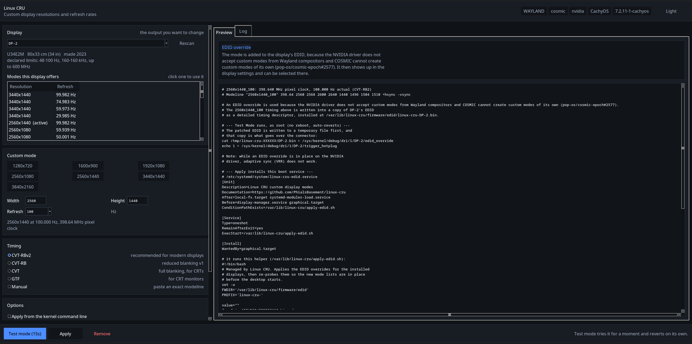

# Linux Custom Resolution Utility (Linux CRU)

A graphical utility for creating and applying custom display resolutions and refresh rates on Linux — the Linux answer to the Windows Custom Resolution Utility. It works out which of the many display paths your system uses and drives the right one for you, on X11 and Wayland, on AMD, Intel and NVIDIA.



## Features

- **Works on X11 and Wayland.** Detects your session, compositor and GPU, and picks the method that actually works there — xrandr on X11, native custom modes on KWin (Plasma 6.6+), sway and Hyprland, or a kernel EDID override everywhere else (GNOME, COSMIC, NVIDIA on Wayland).
- **COSMIC Desktop.** Reads the outputs and their modes through `cosmic-randr`, so the display list, the active mode and the refresh rates are all correct, and the mode is selected with `cosmic-randr` once it is in the list. (COSMIC cannot create a mode of its own — that is an upstream limitation, [pop-os/cosmic-epoch#2577](https://github.com/pop-os/cosmic-epoch/issues/2577) — so the mode is added to the display's EDID.)
- **KDE Plasma.** Custom modes through `kscreen-doctor` on Plasma 6.6 and newer, with the two-step add-then-apply that KWin needs, plus adaptive sync (VRR) control. On X11 the mode is written to `/etc/X11/xorg.conf.d/`.
- **Correct VESA timings.** CVT, CVT reduced-blanking, CVT-RBv2 (lowest pixel clock, best for overclocking) and GTF for CRTs — all verified against `cvt`/`gtf`.
- **Test Mode.** Applies a mode for 15 seconds and reverts on its own, so a bad mode is a brief black screen, not a reboot.
- **EDID override engine.** Patches your monitor's EDID to add modes it doesn't advertise, applied live with no reboot and optionally kept across boots via a systemd service. The files live under `/var/lib/linux-cru`, so it works on immutable distributions too.
- **Monitor information.** Shows what your display declares (refresh range, horizontal frequency, max pixel clock) and warns when a mode exceeds it.
- **Stretched resolutions on KWin.** Forces GPU scaling so a lower resolution fills the whole screen — the stretched-res setup competitive-shooter players want.
- **A rewritten interface.** Light and dark palettes that follow the desktop's own theme, the modes your display offers in a list you can click, resolution presets, a live preview of every command that will run, and a log of everything that was done.

## Installation

No installation required! Linux CRU is distributed as an AppImage. Just download the latest release, make it executable, and run:

```bash
chmod +x Linux_CRU-x86_64.AppImage
./Linux_CRU-x86_64.AppImage
```

The AppImage bundles Python, tkinter and the whole Tcl/Tk runtime, so it runs on a machine with no Python installed.

## Building from Source

If you want to build the AppImage yourself:

1. Clone this repository:
```bash
git clone https://github.com/Guicapau-PT/linux-cru.git
cd linux-cru
```

2. Make the build script executable:
```bash
chmod +x build_appimage.sh
```

3. Run the build script:
```bash
./build_appimage.sh
```

### Dependencies for Building

On Arch Linux (and CachyOS):
- python
- tk
- imagemagick

## Usage

1. Pick the display from the list at the top left — the modes it offers are shown underneath, and clicking one fills in the resolution and refresh rate.
2. Choose a resolution (the preset chips are a shortcut) and a refresh rate, then pick a timing standard (CVT-RBv2 is the sensible default).
3. Read the preview: it shows the exact modeline and, per environment, the real commands, xorg.conf, or systemd/EDID files it will use.
4. Click **Test mode** to try it for 15 seconds with automatic revert.
5. Click **Apply** to keep it. What that does depends on your setup — a live compositor command, an xorg.conf file, or an EDID override installed as a boot service — all shown in the preview first.

The tool never changes your resolution behind your back: applying a custom mode makes it *available to select*, it doesn't force your display onto it.

## Desktop specific notes

| Desktop | What happens |
|---|---|
| **COSMIC** | The mode is added to the display's EDID (COSMIC cannot create modes of its own) and then selected with `cosmic-randr`. It shows up in Settings → Displays. |
| **KDE Plasma 6.6+** | The mode is added with `kscreen-doctor output.X.addCustomMode...` and applied with `kscreen-doctor output.X.mode...`. KDE saves it in `~/.config/kwinoutputconfig.json`. |
| **KDE Plasma below 6.6** | No custom modes; an EDID override is used instead. |
| **KDE Plasma on X11** | The mode is written to `/etc/X11/xorg.conf.d/10-linux-cru.conf` and needs a restart of X to appear. |
| **GNOME** | No custom modes at all; an EDID override is the only option. |
| **sway / Hyprland** | The compositor takes the exact modeline. |
| **NVIDIA on Wayland** | The driver rejects custom modes from the compositor, so the EDID override is used. Note that EDID overrides currently break VRR on NVIDIA. |

### CachyOS and Arch

- The EDID files are installed in `/var/lib/linux-cru/firmware/edid/` (not `/usr/lib/firmware`), so the tool works on immutable systems as well.
- The boot service is a plain systemd unit (`/etc/systemd/system/linux-cru-edid.service`); it runs before the display manager and does not touch the boot configuration.
- If you want the mode at the boot console and the login screen as well, the kernel command line method is used instead: the file is added to the initramfs with `mkinitcpio` and `drm.edid_firmware=` is added to the kernel command line. Remove it from the bootloader menu if the display does not come up.

## Warning

⚠️ Setting incorrect display timings can lead to a blank screen. Test Mode reverts by itself, but for permanent changes keep a way to get back in (another TTY, or removing the setting) in mind. Persistent EDID overrides that use the kernel command line can be undone from the bootloader menu.

## Contributing

Contributions are welcome! Feel free to submit issues and pull requests.

## License

This project is licensed under the MIT License - see the [LICENSE](LICENSE) file for details.

## Acknowledgments

- Based on the Windows Custom Resolution Utility (ToastyX) concept
- Uses Tkinter for the graphical interface
- Thanks to all contributors and testers
