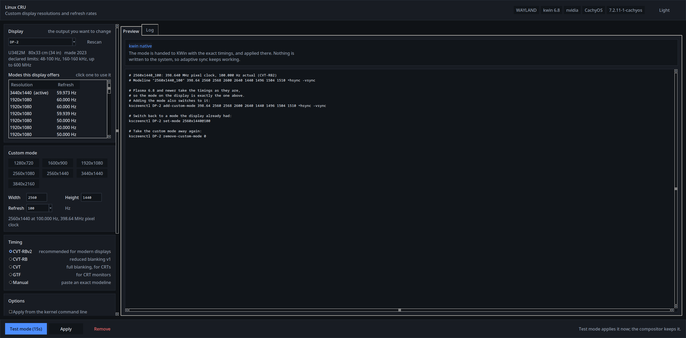

# Linux Custom Resolution Utility (Linux CRU)

A graphical utility for creating and applying custom display resolutions and refresh rates on Linux — the Linux answer to the Windows Custom Resolution Utility. It works out which of the many display paths your system uses and drives the right one for you, on X11 and Wayland, on AMD, Intel and NVIDIA.

A fork of [PhialsBasement/linux-cru](https://github.com/PhialsBasement/linux-cru), with COSMIC support, a reworked interface and fixes on top.

**New to the tool?** The [guide](docs/guide.md) explains everything in plain language — what each part of the window does, how resolution versus refresh versus "timing" relate, and full walkthroughs: *2560x1440 with black bars*, and *stretched to fill*, on top of what is actually happening underneath.


The same tool on KDE Plasma 6.8, where the timings go to KWin as they are — no EDID override, so adaptive sync keeps working:



## Features

- **Works on X11 and Wayland.** Detects your session, compositor and GPU, and picks the method that actually works there — xrandr on X11, native custom modes on KWin (Plasma 6.6+), sway and Hyprland, or a kernel EDID override everywhere else (GNOME, COSMIC, NVIDIA on Wayland).
- **COSMIC Desktop.** The outputs, their modes, the active one and the adaptive-sync state are read through `cosmic-randr`, and the mode is selected with it. (COSMIC cannot create a mode of its own — an upstream limitation, [pop-os/cosmic-epoch#2577](https://github.com/pop-os/cosmic-epoch/issues/2577) — so the mode is added to the display's EDID.)
- **KDE Plasma.** Custom modes through `kscreen-doctor` on Plasma 6.6 and newer, and through **`kscreenctl` on Plasma 6.8 and newer, which takes a full modeline** — so every timing standard (CVT-RBv2, GTF, or one pasted from Windows CRU) reaches the display exactly as calculated, instead of the compositor re-deriving it. Adaptive sync (VRR) control as well. On X11 the mode is written to `/etc/X11/xorg.conf.d/`.
- **Plasma display settings (6.8+).** HDR, wide colour gamut, the colour depth, the scale and the rotation of the selected display are read from the desktop and set on it — and controls the display cannot use are switched off instead of failing when clicked.
- **A smooth interface.** The Plasma questions (each one a process and a DBus round trip) are asked off the window's own thread and the answers are reused for a moment, so the window keeps drawing while it works — on a compositor, a blocked Tcl loop is a hiccup the desktop sees.
- **Correct VESA timings.** CVT, CVT reduced-blanking, CVT-RBv2 (lowest pixel clock, best for overclocking) and GTF for CRTs — all verified against `cvt`/`gtf`.
- **Test Mode.** Applies a mode for 15 seconds and reverts on its own, so a bad mode is a brief black screen, not a reboot.
- **EDID override engine.** Patches your monitor's EDID to add modes it doesn't advertise, applied live with no reboot and optionally kept across boots via a systemd service. The files live under `/var/lib/linux-cru`, so it works on immutable distributions too.
- **Monitor information.** Shows what your display declares (refresh range, horizontal frequency, max pixel clock) and warns when a mode exceeds it.
- **Stretched resolutions on KWin.** Forces GPU scaling so a lower resolution fills the whole screen — the stretched-res setup competitive-shooter players want.
- **A rewritten interface.** Light and dark palettes that follow the desktop's own theme, the modes your display offers in a list you can click, resolution presets, a live preview of every command that will run, and a log of everything that was done.

## Installation

No installation required! Linux CRU is distributed as an AppImage. Just download the latest release, make it executable, and run:

```bash
chmod +x Linux_CRU-x86_64.AppImage
./Linux_CRU-x86_64.AppImage
```

The AppImage bundles Python, tkinter and the whole Tcl/Tk runtime, so it runs on a machine with no Python installed.

## Building from Source

If you want to build the AppImage yourself:

1. Clone this repository:
```bash
git clone https://github.com/Guicapau-PT/linux-cru.git
cd linux-cru
```

2. Make the build script executable:
```bash
chmod +x build_appimage.sh
```

3. Run the build script:
```bash
./build_appimage.sh
```

The script verifies the bundle at the end by running the bundled interpreter with the host's Python hidden — the situation the bundle exists for.

### Dependencies for Building

On Arch Linux (and CachyOS):
- python
- tk
- imagemagick

### Running from source

```bash
python3 linux-cru.py                    # the interface
python3 linux-cru.py --detect           # what the tool sees of this machine
python3 linux-cru.py --self-test        # build the whole interface and exit
python3 linux-cru.py --remove-overrides # undo everything the tool installed (works without a desktop)
```

## Usage

1. Pick the display at the top left. The modes it offers are listed underneath, with the active one marked — click one to fill in the resolution and refresh rate.
2. Choose a resolution (the preset chips are a shortcut, the fields take anything) and a refresh rate, then pick a timing standard (CVT-RBv2 is the sensible default).
3. Read the preview: it names the method that will be used and shows the exact modeline and, per environment, the real commands, xorg.conf, or systemd/EDID files it will use.
4. Click **Test mode** to try it for 15 seconds with automatic revert.
5. Click **Apply** to keep it. What that does depends on your setup — a live compositor command, an xorg.conf file, or an EDID override installed as a boot service — all shown in the preview first.

The tool never changes your resolution behind your back: applying a custom mode makes it *available to select*, it doesn't force your display onto it.

**Remove** undoes everything this tool installed: the EDID overrides, the boot service and the X11 configuration.

## Desktop specific notes

| Desktop | What happens |
|---|---|
| **COSMIC** | The mode is added to the display's EDID (COSMIC cannot create modes of its own) and then selected with `cosmic-randr`. COSMIC reads the display's modes when it starts, so the mode appears in Settings → Displays after the next login. |
| **KDE Plasma 6.8+** | The mode is handed to KWin as a full modeline with `kscreenctl`. Adding it and switching to it is one step for you; underneath they are two calls, because "add custom mode" does not switch. KDE saves it in `~/.config/kwinoutputconfig.json`. The display settings are set from the interface too: HDR, wide colour gamut, colour depth, scale and rotation. |
| **KDE Plasma 6.6–6.7** | The mode is added with `kscreen-doctor output.X.addCustomMode...` and applied with `kscreen-doctor output.X.mode...`. Only the timings the compositor can compute itself (CVT, CVT-RB) are possible; anything else needs an EDID override. |
| **KDE Plasma below 6.6** | No custom modes; an EDID override is used instead. |
| **KDE Plasma on X11** | The mode is written to `/etc/X11/xorg.conf.d/10-linux-cru.conf` and needs a restart of X to appear. (Plasma 6.8 is the last release with an X11 session.) |
| **GNOME** (48+) | No custom modes; an EDID override is the only option. gdctl is used to list the modes Mutter has and to switch to the new one while keeping the scale, rotation and the other displays, including the adaptive-sync (VRR) setting, which on GNOME is a mode variant. |
| **sway / Hyprland** | The compositor takes the exact modeline. |
| **NVIDIA on Wayland** | The driver rejects custom modes from the compositor, so the EDID override is used — **except on Plasma 6.8 and newer, where KWin hands over the exact timings and the driver applies them**. Either way the driver only switches to a resolution it already has, so a resolution the display only advertises through DisplayID still needs the override. Note that EDID overrides break VRR on NVIDIA. |

### CachyOS and Arch

- The EDID files are installed in `/var/lib/linux-cru/firmware/edid/` (not `/usr/lib/firmware`), so the tool works on immutable systems as well.
- The boot service is a plain systemd unit (`/etc/systemd/system/linux-cru-edid.service`); it runs before the display manager and does not touch the boot configuration. It is what makes the mode show up in the display settings at every login — some desktops (COSMIC, GNOME) only read the display's modes when they start, so a live override is not enough for them.
- If you want the mode at the boot console and the login screen as well, the kernel command line method is used instead: the file is added to the initramfs with `mkinitcpio` and `drm.edid_firmware=` is added to the kernel command line. Remove it from the bootloader menu if the display does not come up.

## Things worth knowing

These were found by working on a real machine (COSMIC on CachyOS, kernel 7.2, NVIDIA 615.78.08, an AOC U34E2M) and are written up in [docs/research](docs/research/).

- **A mode the display advertises may still not exist.** That monitor advertises 2560x1440 — but only in its DisplayID extension, and the NVIDIA driver does not turn DisplayID timings into modes, so the resolution was simply not selectable. Adding the same timing as a CTA-861 detailed timing descriptor made it appear at once. That is what the override does.
- **The driver has the last word, not the compositor.** On Plasma 6.8 the exact timings reach the driver — but it will only switch to a resolution it already has. The tool asks the driver what it has (the connector's mode list) and picks the method accordingly: the compositor when the resolution is known, the EDID override when it is not.
- **The kernel having a mode and the desktop having it are two different things.** After an override the kernel's connector mode list has the new mode immediately, but a compositor keeps its own copy of the mode list and may not read it again while it runs (COSMIC does not). The tool waits for the compositor, not just the kernel, and says so when the desktop has not read the display yet.
- **A hotplug event is not a re-detect.** `echo detect > .../status` and `echo 1 > .../trigger_hotplug` make the driver rebuild its mode list, but they did not make cosmic-comp look at the display again. Writing `disconnect` and then `detect` — what a replug does in software — is the way to make the connector go away and come back, and the tool offers it when the desktop has not read the mode, with a warning: the screen goes blank while it happens.

## Troubleshooting

| Symptom | Cause |
|---|---|
| The login screen froze after a kernel update | A display setting or override that lived through the update. Get to a TTY (`Ctrl+Alt+F3`) or log in over SSH and run `python3 linux-cru.py --remove-overrides` — it takes everything this tool installed away and needs no graphical session, **no Tk, and no `--yes` unless you script it** (`--yes` to confirm, `--connector DP-1` to keep the others). A kernel update can also change which modes a driver accepts, which is invisible until the desktop has to start with one. |
| `Could not apply the EDID override` | The kernel's debugfs is not available: `CONFIG_DEBUG_FS` is off, or the kernel is locked down (`cat /sys/kernel/security/lockdown`). |
| `The kernel did not pick up WxH` | The driver refused the mode. The pixel clock is probably over what the connection can carry — check `dmesg`. |
| `The desktop has not read it yet` | The compositor only reads the display's modes when it starts. Log out and back in, or replug the display. |
| The mode is there but not selectable | Some compositors (COSMIC, GNOME) only list modes their desktop knows about; the mode has to be in the display's EDID at boot, which is what **Apply** does. |
| VRR stopped working | An EDID override disables adaptive sync on the NVIDIA driver while it is in place — the override replaces the display's own EDID (three blocks, with DisplayID) with a shortened two-block one, and the display stops reporting it can do it. Remove the override and the display's own EDID comes back. |

## Warning

⚠️ Setting incorrect display timings can lead to a blank screen. Test Mode reverts by itself, but for permanent changes keep a way to get back in (another TTY, or removing the setting) in mind. Persistent EDID overrides that use the kernel command line can be undone from the bootloader menu.

## Contributing

Contributions are welcome! Feel free to submit issues and pull requests.

The test suite is plain Python with no dependencies:

```bash
for t in tests/test_*.py; do echo "== $t"; python3 "$t"; done
```

The tests that build the interface need a display; CI runs them under Xvfb.

## License

This project is licensed under the MIT License - see the [LICENSE](LICENSE) file for details.

## Acknowledgments

- **[PhialsBasement](https://github.com/PhialsBasement/linux-cru)** — the original Linux CRU, which this is a fork of. The research behind the project, the VESA timing calculators, the EDID override engine, the KWin stretch work and the overall design are theirs, and the copyright in [LICENSE](LICENSE) is theirs. This fork adds COSMIC support, the reworked interface, and a number of fixes on top.
- The [Windows Custom Resolution Utility](https://www.monitortests.com/forum/Thread-Custom-Resolution-Utility-CRU) (ToastyX) — the idea this whole project is modelled on.
- Everyone who reported a problem, tested a build or sent a patch to either project.
